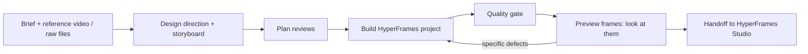

<h1 align="center">Motion Harness</h1>

<p align="center">
  Turn a brief into an editable <a href="https://hyperframes.heygen.com">HyperFrames</a> motion-graphics project with <a href="https://opencode.ai">OpenCode</a>.<br>
  It plans first, builds, checks, <i>looks at the frames</i>, fixes what it finds, then hands the project to HyperFrames Studio.<br>
  <b>It never renders or exports.</b> You preview and render in Studio.
</p>

<p align="center">
  <picture>
    <source media="(prefers-color-scheme: dark)" srcset="docs/screenshots/home-dark.png">
    
  </picture>
</p>

<p align="center"><sub>The dashboard on a real workspace. Nothing is sent to a model until you press <b>Create</b>.</sub></p>

---

## What you get

<p align="center"></p>

<p align="center"><sub>Four frames from <code>ex-world-tides</code>, built by the harness workflow: a persistent night-sky world, route HUD, captions, and a hero object in every scene.</sub></p>

- **A director's workflow, not a prompt-to-HTML shortcut.** Brief → design direction → storyboard (why each scene exists, what the viewer notices, one hero move) → plan reviews → build → quality gate → preview frames → targeted fixes → handoff. Phases are enforced by the CLI.
- **A small motion-design library.** Typography reveals, transitions, charts, image depth, audio-cue helpers, plus a *world layer*: sky, HUD, callouts, gauges, path-and-traveller, CSS-3D stage, karaoke captions.
- **Honest quality gates.** `hyperframes check` plus harness checks (structure, timing, palette, type size, determinism, scene drift, **sparse scenes with no hero object**, **near-empty frames**). Findings, not invented scores. A visual claim needs fresh frames the agent actually opened.
- **Your own material.** Attach a reference video (probed, sampled into frames, scene cuts detected) or raw files (imported, catalogued, checked for use).
- **Revisions that preserve work.** Each revision names the scenes it touches and logs a reason; the gate flags edits to scenes you meant to keep.

## How it works



Everything the agent does goes through `mh_*` tools that wrap one CLI (`harness/mh.mjs`), so the same state files and checks work from the dashboard, from OpenCode, or from a terminal.

## The dashboard

Double-click **`Start Dashboard.cmd`** (or run `node dashboard/server.mjs`) and open <http://127.0.0.1:4177>.

It connects to OpenCode the way [Leadsmith](https://github.com/HariNayan/Leadsmith) does: there is no server API. It runs the CLI headless (`opencode run --format json --agent motion-director`) from this folder and streams the steps into a live log.

<table>
  <tr>
    <td width="50%"><br><sub><b>Projects.</b> Phase, gate result and frame evidence at a glance.</sub></td>
    <td width="50%"><br><sub><b>A project.</b> Preview frames, details, design system, and <i>Revise with OpenCode</i>.</sub></td>
  </tr>
  <tr>
    <td><br><sub><b>Storyboard.</b> Every scene states why it exists and its hero object.</sub></td>
    <td><br><sub><b>Quality.</b> Gate findings and a checklist where every judgement carries its evidence.</sub></td>
  </tr>
  <tr>
    <td><br><sub><b>Connection.</b> OpenCode status, providers (names only, never keys) and model.</sub></td>
    <td><br><sub><b>Light, dark or auto.</b></sub></td>
  </tr>
</table>

**Reference video and raw files.** Use *Attach reference video or files* (or drop files on the prompt box). Files stream into `inbox/` (up to 4 GB each; executables are refused). Mark each as a **Reference** (look, pacing, structure; analysed, never copied) or a **Raw asset** (real material to use in the video). The agent imports them with `mh_importfile`: reference videos are probed, sampled into 8 frames and scanned for scene cuts (approximate times; easing curves are not measurable), and raw assets are copied to `assets/source/`. The gate warns about imported assets no scene uses. The project's **Files** tab shows both.

**Safety.** Local only: it binds to `127.0.0.1` and rejects non-loopback `Host` headers and cross-origin POSTs. Project names and model ids are validated, and the brief goes on stdin, never through a shell. The agent's permissions in `opencode.jsonc` deny `hyperframes render`, `publish`, cloud renders and `ffmpeg`.

> Preview frames are git-ignored because they are regenerated, so a fresh clone shows no thumbnails until you press *Capture frames* on a project.

## Example videos

| Project | Style | What it shows |
| --- | --- | --- |
| **`ex-world-tides`** | Dense, persistent world (the quality bar) | Night-sky world, HUD, captions with *synthetic* word timing, CSS-3D Earth, gauge and tide curve |
| **`ex-data-vertical`** | Swiss data poster, 9:16 | Counter, bar chart with peak highlight, slat transitions |
| **`ex-editorial`** | Flat editorial, 16:9 | Heavy type, colour-block wipes, a drawn diagram (deliberately minimal) |

<table>
  <tr>
    <td></td>
    <td></td>
    <td></td>
    <td></td>
  </tr>
</table>

Also included: `smoke-primitives` (exercises library primitives no real project used) and three of HyperFrames' own shipped examples, adopted with `mh adopt` so the same gate runs on them. [`eval/ACCEPTANCE-REPORT.md`](eval/ACCEPTANCE-REPORT.md) lists the actual gate findings per project.

## Quick start

Needs Node (developed on 24), [OpenCode](https://opencode.ai) (`npm install -g opencode-ai`, then `opencode auth login`), and FFmpeg on `PATH`.

```bash
# the dashboard
node dashboard/server.mjs            # http://127.0.0.1:4177

# or from OpenCode (the motion-director agent is the default in this folder)
opencode                             # then:  /motion-new 30 second explainer on ...

# or the CLI directly
node harness/mh.mjs new my-film --format horizontal --depth high
node harness/mh.mjs preset my-film night-sky     # dense persistent-world design system
node harness/mh.mjs lint my-film                 # plan lint
node harness/mh.mjs gate my-film                 # hyperframes check + harness checks
node harness/mh.mjs frames my-film               # preview stills (not a render)
node harness/mh.mjs studio my-film               # start the HyperFrames Studio preview
```

## Quality gate and depth

| Depth | Plan reviews | Revision limit | Frame evidence |
| --- | --- | --- | --- |
| `draft` | 1 | 3 | optional |
| `standard` | 2 | 5 | recommended |
| `high` | 3 | 8 | required |

Higher depth buys more planning and verification, not more effects. A deliberately sparse look (flat editorial, Swiss poster) is allowed only with `designSystem.density: "minimal"` and a written reason.

## Repository layout

```
dashboard/        local web app: server.mjs, public/ (UI), test/ (stub-OpenCode integration tests)
harness/mh.mjs    the CLI: phases, plan lint, gate, frames, import, revisions, checklist, handoff
motion-lib/       mh-motion.* primitives, mh-world.* world layer, presets/night-sky.json   (see motion-lib/README.md)
.opencode/        motion-director + motion-critic agents, /motion-* commands, mh_* tools
opencode.jsonc    default agent and permissions (no render / publish / ffmpeg)
AGENTS.md         the agent's operating procedure and rules
harness.config.json, templates/   depth presets, formats, planning templates
projects/<slug>/  HyperFrames projects; harness state in .mh/ (brief, direction, storyboard, decisions, revisions, checklist)
eval/             acceptance runner, report, model-testing protocol   (see eval/README.md)
docs/             README images
```

## Limits (read before relying on it)

- **The OpenCode model is untested here.** The dashboard and tools are tested against a stub; the workflow depends on your model's planning and on it actually opening frames. Reference analysis needs a **vision-capable** model. The protocol for measuring a model is in [`eval/README.md`](eval/README.md).
- **Nothing is rendered by this repo.** Visual claims rest on snapshot frames, and the examples carry no audio (captions use labelled synthetic timing).
- Scripted layers (sky, HUD, captions) are built from data, so Studio cannot edit them as plain HTML.
- Studio edits change files the harness has locked; run `mh lock` or log a revision afterwards.
- One dashboard job runs at a time.

## Credits

Built on [HyperFrames](https://hyperframes.heygen.com) and [OpenCode](https://opencode.ai). The dashboard's design language and its way of connecting to a coding agent follow [Leadsmith](https://github.com/HariNayan/Leadsmith).
