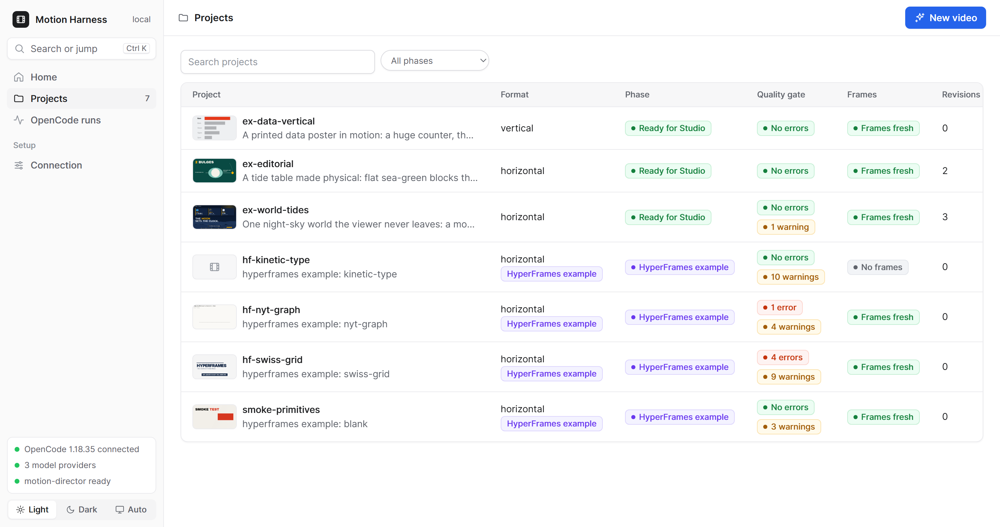
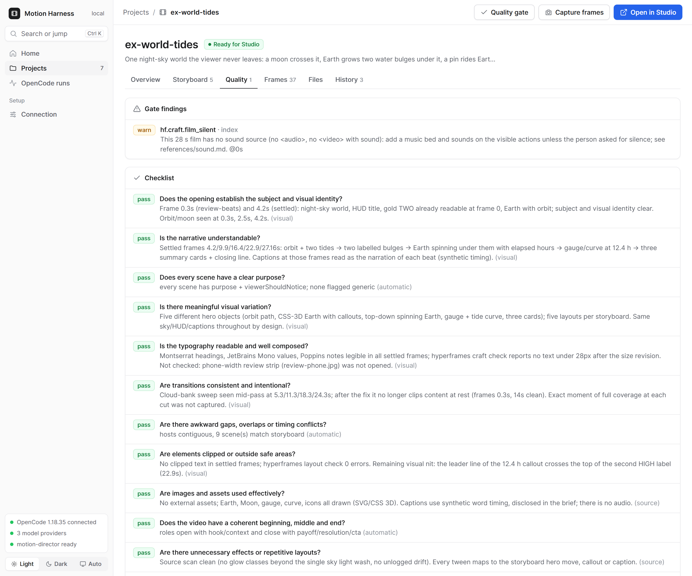

# Evaluation

<table>
  <tr>
    <td></td>
    <td></td>
  </tr>
</table>
<sub>The acceptance suite is the set of projects in the dashboard's table; each project's gate findings and checklist evidence are what `run-acceptance.mjs` reports.</sub>

Two separate questions:

1. **Does the harness itself work** (tooling, gates, library)? — Acceptance suite below. Run by a script, no model needed.
2. **How good is the configured OpenCode model at using it?** — Model protocol below. **Not yet run** (see status).

## 1. Acceptance suite (harness, no model)

`node eval/run-acceptance.mjs` (add `--regate` to re-run gates, `--frames` to recapture frames first) writes `eval/ACCEPTANCE-REPORT.md` from each project's `.mh/gate-report.json`. It reports counts and the findings themselves, never scores.

| project | style / what it exercises | origin |
| --- | --- | --- |
| `ex-world-tides` | **quality bar (dense)**: persistent night-sky world, route HUD, karaoke captions (SYNTHETIC word timing, no audio), cloud-bank transitions, and a hero object per beat (orbit path + moving Moon, CSS-3D Earth with callouts, top-down spinning Earth, gauge + tide curve, illustrated cards). Built to the `night-sky` preset at `high` depth | built through the full workflow (3 plan reviews, 3 logged revisions driven by frame review, handoff) |
| `ex-editorial` | deliberately **minimal** 16:9 contrast: flat colour grounds, heavy grotesque, wipe transitions, drawn diagram, counter (`density: minimal` with a reason) | built through the full workflow (2 revisions, handoff) |
| `ex-data-vertical` | deliberately **minimal** 9:16 data poster: condensed numerals, bar chart with peak highlight, slat transitions, light → ink slab | built through the full workflow (1 build-phase fix, handoff) |
| `smoke-primitives` | one-file composition exercising primitives no real project used: iris, parallax, cropOpen, tracking, punch, audio pulse/onWord (synthetic cues), match, callout, rules, form, dip, bg drift | adopted blank + hand-written; **synthetic** cues in `eval/synthetic-cues.json` |
| `hf-kinetic-type`, `hf-swiss-grid`, `hf-nyt-graph` | HyperFrames' own shipped examples (`hyperframes init --example …`) — three other styles (kinetic type, Swiss grid, print-editorial chart) | adopted via `mh adopt`; technical gate only (they have no brief/storyboard) |

What the suite can and cannot show:
- It shows the project passes `hyperframes check` plus the harness checks, and whether fresh preview frames exist.
- Frame-based judgement was done by the agent opening the snapshot images for the two built projects (notes are in each `.mh/checklist.json`). Adopted examples have no checklist judgement.
- It does **not** show that a different model would produce comparable work, and nothing was rendered.

## 2. Model protocol (OpenCode model in use)

Why: the workflow assumes strong planning and visual self-critique. A different model may skip phases, write invalid HTML, or not actually open frames. Measure, then change the prompts/tools, not the theory.

Setup: pick the model with OpenCode's own config/`--model`. Do not hard-code one in `opencode.jsonc`.

Run three different briefs through `/motion-new` (one horizontal explainer, one vertical data piece, one brief with a reference image), each with `--depth standard`:

```bash
opencode run --command motion-new --model <provider/model> "<brief text>"
```

For each run record (copy `projects/<slug>/.mh/` out afterward):
1. Did it follow the phases in order? (`decisions.jsonl` phase entries; any `forced`?)
2. Plan quality: `plan-lint.json` errors on first lint, and how many `plan-review` entries changed anything.
3. Did it open frames? (Check the session transcript for image reads after `mh_frames`; a checklist item with `basis: visual` and no image read is a false claim.)
4. First-gate error count vs final; defects found by frame review vs by the gate.
5. Did it touch scenes outside its `mh_revise` list? (gate `rev.drift`)
6. Did it attempt `hyperframes render`/publish? (should be denied by permissions)
7. Steps/tokens used versus the depth's `agentStepBudget`.

Then change one thing at a time (prompt wording in `AGENTS.md`, a tool description, a lint rule), rerun the failing brief, and note the effect in `eval/MODEL-LOG.md`.

### Status

Not run. OpenCode here has credentials for Cloudflare Workers AI and GitHub Models, and `GEMINI_API_KEY` in the environment, but no default model is configured and running the protocol spends the user's API quota. Run it when ready and record results in `eval/MODEL-LOG.md`.
